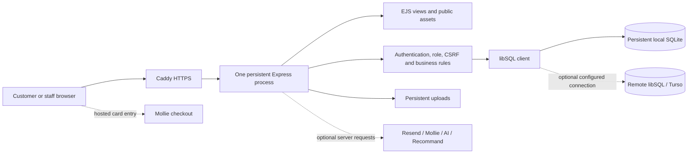

# ShopEasy architecture — 2.8.95 / audit repair FIX03

This describes the shipped source structure and intended runtime. It is a maintenance map, not proof that an external service or production host has been validated. Read [Features and limitations](FEATURES-AND-LIMITATIONS.md) and the generated [schema reference](SCHEMA.md) alongside it.

## Stack and deployment boundary

| Layer | Actual implementation |
| --- | --- |
| Runtime | Node.js >=24.22.2 <25, ECMAScript modules, npm lockfile |
| HTTP / rendering | Express 5.3.0; EJS 7.0.2; server-rendered HTML with public JavaScript/CSS enhancements |
| Database | `@libsql/client` 0.18.0; SQLite-compatible SQL; local persistent file by default, optional remote libSQL/Turso URL |
| Request controls | Helmet 8.3.0, cookie-parser, express-rate-limit 8.7.5, application CSRF/session/role checks |
| Media / MFA | Multer 2.5.0 with application image validation; qrcode-generator; application TOTP/recovery-code implementation |
| Optional services | Resend email, Mollie hosted cards, configured AI HTTP endpoint, Recommand Peppol transport |
| Developer checks | Node test runner, TypeScript 6.0.3 scoped JS checks, Python 3.13 / Playwright 1.62.0 buyer browser QA |

Version details come from [package.json](package.json), [package-lock.json](package-lock.json) and [requirements-qa.txt](requirements-qa.txt). `promise-limit` resolves to the private first-party `@shopeasy/task-limit` implementation in [vendor/promise-limit](vendor/promise-limit/PROVENANCE.md), preserving the factory/limiter surface used by the locked libSQL client. The external package was replaced without replacing the libSQL API.

The current lockfile includes the `multer@2.5.0` SHA-512 integrity value. Earlier release notes about Multer 2.4.0 or a missing 2.5.0 integrity value are historical and superseded for this source tree; see [Security notes](SECURITY.md). A recorded lockfile value does not establish the current absence of dependency advisories.

The supported production topology is a **single persistent Node process/instance**, with `RATE_LIMIT_BACKEND=memory-single-instance`, HTTPS reverse proxy and persistent storage. The [Linux deployment](DEPLOYMENT.md) uses Caddy and systemd. Multiple independent app processes do not share the in-memory limiter. Cloudflare source generation and Durable Object code remain present, but the deploy preflight blocks Workers authentication because the runtime's PBKDF2 cap conflicts with the required 600,000 iterations. Vercel/AWS Lambda are explicitly rejected. See [Cloudflare deployment status](CLOUDFLARE-DEPLOYMENT.md).



Remote database support is retained in the adapter; local SQLite observations do not prove remote transaction/concurrency behavior or provider quotas.

## Code map

| Location | Responsibility |
| --- | --- |
| [src/bootstrap.js](src/bootstrap.js) | Loads dotenv before importing the server on Node. Workers inject configuration separately. |
| [src/server.js](src/server.js) | Express application, middleware, storefront/account/Manager routes, request validation, views and provider orchestration. This is the main routing module. |
| [src/database.js](src/database.js) | Selects the configured database URL, creates the libSQL client, enables WAL for local files and exposes SQL helpers. |
| [src/local-sqlite-transaction-queue.js](src/local-sqlite-transaction-queue.js) | Serializes local-file write/deferred transaction lifetimes so one client cannot interleave those transactions; direct standalone writes are not part of this queue and remote clients retain native driver behavior. |
| [src/db.js](src/db.js) | Startup schema/migrations, seed/bootstrap data and exported catalogue, inventory, session, order, financial, customer and audit operations. |
| [src/auth.js](src/auth.js), [src/password-hashing.js](src/password-hashing.js), [src/mfa.js](src/mfa.js) | Database sessions, authentication and role guards, PBKDF2/legacy verification, encrypted TOTP state and recovery codes. |
| [src/security.js](src/security.js), [src/shared-rate-limiter.js](src/shared-rate-limiter.js) | CSRF, input/money/date/image primitives, new-password policy, single-process/Workers limiter selection. |
| [src/pricing.js](src/pricing.js), [src/commerce-rules.js](src/commerce-rules.js), [src/launch-gate.js](src/launch-gate.js) | Integer money arithmetic, operator-configured regional fees/tax, checkout readiness. |
| [src/order-cancellation-rules.js](src/order-cancellation-rules.js), [src/order-email-delivery-rules.js](src/order-email-delivery-rules.js) | Shared customer cancellation predicates and bounded order-email retry rules; transactional enforcement lives in `db.js`. |
| [src/local-navigation.js](src/local-navigation.js) | Shared safe local navigation parsing for routes and the Back-link partial. |
| [src/product-variants.js](src/product-variants.js), [src/product-images.js](src/product-images.js) | Variant selection/legacy input and gallery normalization. Transactional storage lives in `db.js`. |
| [src/customer-engagement.js](src/customer-engagement.js), [src/gift-cards.js](src/gift-cards.js), [src/bundle-promotions.js](src/bundle-promotions.js) | Newsletter/stock alerts/reviews, gift-card primitives and bundle discount rules. |
| [src/services](src/services/ai.js) | AI search, email, payments, bank transfer, checkout intent, Peppol transport and security-event helpers. |
| [views](views/home.ejs), [public](public/js/app.js) | EJS page/partial templates, JavaScript, CSS, images and upload mount. Interface translation is distinct from seller-authored content. |
| [generated/cloudflare-views.js](generated/cloudflare-views.js) | Generated template source map for the retained Workers build path; rebuild after changing views. |
| [scripts](scripts/verify-and-package.mjs), [test](scripts/run-tests.mjs), [qa](qa/README.md) | Release/deployment/backup utilities, Node regressions and self-contained browser fixture runner. |

## Startup and persistent state

`npm start` imports `bootstrap.js`, then the server and its database modules. `db.js` initializes and upgrades schema on import. Required migration failures reject startup; they must not be treated as a successful import with an old schema. This is why every upgrade needs a backup and a migration rehearsal on a separate copy. The generated [schema JSON](database-schema.json) describes a freshly initialized disposable database, not the state of an existing shop.

Database selection is `TURSO_DATABASE_URL` with token for Workers, otherwise `DATABASE_URL`, then the backward-compatible `SHOP_DATABASE_URL`, then local `data/shop.db`. Persistent Node can use a local `file:` URL or a remote configured URL. Never point test/schema generation at an operator database. Environment configuration is documented in [Quick start](QUICK-START-AND-ENV.md) and [.env.example](.env.example).

In the Linux release layout, `/opt/shopeasy/current` selects code under `releases/`; `.env`, `data`, `public/uploads` and `backups` live outside releases. Images normally use filesystem uploads; the schema also contains `uploaded_assets` for database-backed storage. These are shared shop media, not attributed customer uploads. Backups must account for both DB BLOBs and files.

## Request and authentication flow

Helmet supplies security headers/CSP. Middleware parses cookies/forms, attaches a database-backed session, resolves locale/store settings and checks CSRF for state-changing requests, with explicit handling for uploads and provider callbacks. Private pages carry cache/robot restrictions; token-bearing early CSRF errors also receive non-cacheable headers. Route handlers still enforce role/ownership: the existence of a UI button is not the permission boundary.

Customers can register, sign in, change a password and view their own orders. Public registration always creates a pending customer and never signs that customer in. Valid new-address and duplicate-address submissions return the same generic HTTP 200 notice. With email configured, the link opens a read-only verification form; activation requires an explicit CSRF-protected POST with both the mail token and the original registration password. An unsolicited link click cannot activate an attacker's pending credential. Without email, a Manager can approve ownership after independent identity checks, but must set a different, privately agreed strong password; the original pending password cannot be activated through Manager approval. Approval replaces the password, revokes old sessions/reset/verification tokens and records an audit event atomically. Existing verified accounts and guest checkout remain available. The route, database transition and customer form are in [server.js](src/server.js), [db.js](src/db.js) and [customers.ejs](views/admin/customers.ejs).

Manager authentication includes TOTP setup/verification and single-use recovery codes before full management access. A restricted `admin` role receives a read-only overview and account-security access; it does not manage the store or inspect the Manager audit screen. Production session cookies use the `__Host-sid` name with Secure, HttpOnly, SameSite=Lax and `/` scope. Logout revokes the server session.

New/set/reset passwords use `isStrongEnoughPassword`: at least 15 trimmed Unicode code points, a maximum input length of 200 UTF-16 code units, a small offline example blocklist and repetition checks. Password verification is deliberately separate, so valid older credentials still work. PBKDF2-SHA-256 uses 600,000 iterations; legacy scrypt verification is retained on Node. This is not a full breached-password service.

Registered orders require the logged-in owner. Guest orders require a bearer matching the stored hash. `POST /order-lookup` and `POST /order/:id/return-request` accept the HttpOnly order cookie or the explicit `guestAccessToken` POST field, together with the matching email/order details. The confirmation-page GET and its cancel/return POST routes require the cookie for guest access. URL bearers are rejected. Successful private-code lookup refreshes the root-scoped HttpOnly order cookie. Knowing an email/order number alone does not grant lookup or return access. A lost guest bearer requires the operator's identity-checked support process; the application does not invent email-based access proof. See the exact access matrix in the [route reference](API-REFERENCE.md#checkout-and-orders).

## Checkout and financial flow

```mermaid
sequenceDiagram
    participant B as Browser
    participant S as Express
    participant D as Database
    participant P as Optional Mollie API
    B->>S: Submit checkout, CSRF and current session intent
    S->>D: Re-read products/options, stock, discounts and configuration
    S->>D: Transaction: order snapshot + items + reservations + idempotency
    D-->>S: Existing or new order
    alt COD
        S-->>B: Protected confirmation
    else Manual bank transfer
        S-->>B: Saved payment instructions; pending statement review
    else Hosted card
        S->>P: Create payment for exact order amount/currency
        S-->>B: Redirect to validated hosted URL
        P->>S: Webhook identifier
        S->>P: Fetch authoritative payment
        S->>D: Validate reference, mode, amount/currency, mark paid
    end
```

The server recalculates amounts from stored products, selected variants, sale windows, automatic/bundle/coupon rules, destination rules and gift-card state; browser totals are advisory. Orders snapshot item names/options, prices/costs, currency, delivery/tax rules and accepted terms. Idempotency/session intent prevents repeated checkout from creating duplicate reservations. Financial amounts use currency-aware integer minor units despite legacy `_cents` column names.

COD normally progresses `pending → processing → shipped → completed`; payment-backed orders require verified `paid` state before fulfilment. Inventory remains reserved during fulfilment and is consumed on completion; valid cancellation releases it once. Pending orders have no automatic reservation timeout in this source. Card failure reconciliation and Manager cancellation controls depend on provider/payment state; see [Manager guide](MANAGER-GUIDE.md). A browser success URL or webhook body alone is not proof of payment.

Customer cancellation buttons and handlers use the same policy: pending COD may cancel directly; processing COD and pending bank transfer may request cancellation when no request is pending. A previously rejected eligible request may be resubmitted. Mollie orders cannot be directly cancelled through this customer action even if the local provider reference is missing. Request notices reflect persisted request state rather than treating an unsuccessful action as an existing request.

Manual bank transfer records receipt only after the Manager verifies the bank statement and exact amount/currency/reference. Returns can record inspection/restock, an externally executed refund or exchange shipment; the return tool does not transfer money. Replacement shipment is a like-for-like exchange of the original product/variant and return quantity. Its transaction subtracts only unreserved available stock and changes the return state once; a duplicate shipment action cannot deduct stock again. Receiving/restocking the original item is a separate explicit step. The Manager return queue counts matching requests and exposes all pages of 50 rows, preserving the status filter during paging. The separate gift-card credit action updates the internal card ledger. Mollie financial snapshots record provider-reported refunded/charged-back totals; recording a snapshot does not initiate a refund.

## Order-email delivery and recovery

Order confirmation/status email remains opt-in through `ORDER_CONFIRMATION_EMAILS=1` and `ORDER_STATUS_EMAILS=1`, with configured Resend credentials. The application records each order/event delivery in `order_email_deliveries`. The first claim stores the exact serialized recipient/sender/subject/HTML/text payload, a random provider idempotency key and the credential fingerprint. Retries reuse that payload and key even if the order, locale or branding has since changed. A changed provider credential blocks retry until reconciliation; a stale worker cannot complete a newer claim.

The application permits at most three attempts per generation within 23 hours of its first attempt, uses a 60-second claim lease, and allows another attempt after 5 seconds and then 10 seconds following failures. `ORDER_EMAIL_DAILY_LIMIT` counts attempts, including retries, across the shop's delivery rows per UTC day (default 10, bounded 1–100). These are application limits implemented in [order-email-delivery-rules.js](src/order-email-delivery-rules.js) and [db.js](src/db.js), not independently verified provider guarantees. There is no background retry scheduler: order lifecycle actions or an explicit Manager retry request initiate an attempt.

The order detail page shows safe delivery metadata and Manager-only retry/reconciliation forms. When the retry budget/window is exhausted, legacy state is incomplete, or credentials change, the Manager must check the original provider account. A confirmed accepted message is marked sent without transmitting again. Only confirmed non-delivery permits a new payload/key generation, and reconciliation itself never sends. The daily attempt quota is retained. An unresolvable timeout must remain unresolved rather than being guessed as not sent. See [Manager email recovery](MANAGER-GUIDE.md#review-and-recover-order-email).

## Data integrity and privacy boundaries

Category reparent validation/update share a write transaction; recursive descendants use `UNION` so a pre-existing cycle terminates. SQL sale filtering/sorting and JavaScript price display use normalized timestamp interpretation. Required legacy-variant rebuilds fail startup on error instead of swallowing copy failure. These defenses should be kept when extending database operations.

Manager privacy tools offer export, eligible deletion, or explicit `minimize-retain-financial`. Minimization requires a documented retention-policy reference and an acknowledgement; unresolved orders/returns block it. It removes the account, revokes access and clears selected contact/free-text fields while preserving financial line items, amounts, dates, country, payment/refund references and gift-card ledger relations. Financial-ledger deletion is not bypassed by dropping foreign keys. Retained data is pseudonymous and can remain linkable through outside financial systems. The application does not decide retention periods/legal holds or certify lawful erasure; see [Admin guide](ADMIN-GUIDE.md).

## Build, QA and release flow

`npm test` invokes [scripts/run-tests.mjs](scripts/run-tests.mjs); it starts workers with isolated temporary database paths through [scripts/test-environment.mjs](scripts/test-environment.mjs). The launcher also sets the child process's temporary-directory environment to that run directory; the preload validates it against the child's own `os.tmpdir()` before selecting a per-worker DB. The [browser runner](qa/README.md) copies allowlisted runtime source into its own temporary fixture, binds loopback on an OS-selected port, exercises real local TOTP/COD, and deletes private fixture state. Optional provider email interception is explicitly simulated. Axe findings preserve both violations and incomplete checks; neither a route count nor a zero-violation subset establishes WCAG/ASVS conformity.

For this repair, JavaScript handler checks use controlled DOM/events/fetch models, and template checks render EJS with synthetic data. They do not establish actual layout, assistive-technology announcements, focus behavior or BFCache eligibility. Browser execution remained blocked in the audit environment by Chromium's required local socket/process setup. Live Resend, Mollie and other provider transport was not verified. The separate repair evidence records the commands and results without replacing the original audit failures.

[Release verification](RELEASE-VERIFICATION.md) prepares a disposable copy, runs required checks and emits a new manifest/ZIP without installing into or rewriting the source. [deploy.sh](deploy.sh) prepares and validates a new release before atomically switching `current`, restarting and checking health/readiness. Its rollback selects previous code; it does not revert schema/data. [Backup and restore](DATABASE-BACKUP-RESTORE.md) uses an encrypted logical DB/media snapshot and a separate-empty-target restore workflow. Actual host recovery, live providers and Windows/macOS execution still need environment-specific validation.
