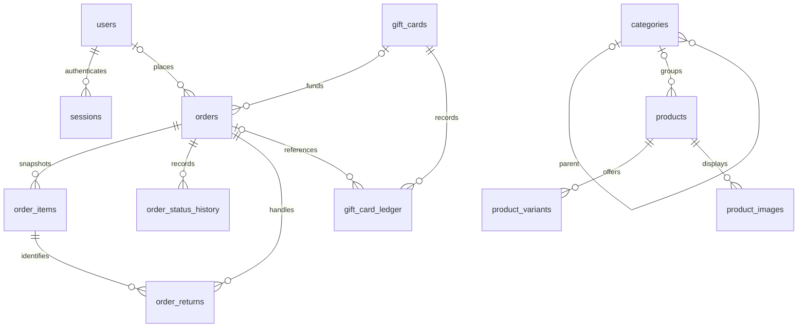

# Database schema reference

This reference describes a fresh local database produced by the included application startup code. It is a maintenance aid, not a migration script or a copy of customer data. The exact source version, individual SHA-256 digests, combined source digest, generation command and complete SQLite results are in [database-schema.json](database-schema.json).

The captured schema contains **32 application tables, 325 columns, 64 indexes (38 explicit and 26 automatic), 37 foreign-key rows, 5 triggers and no views**. SQLite's internal `sqlite_sequence` table is recorded separately. The actual disposable run used Node 24.22.2, the installed `@libsql/client` adapter and SQLite 3.45.1; foreign keys were enabled, `PRAGMA integrity_check` returned `ok`, and `PRAGMA foreign_key_check` returned no rows.

## Reproduce safely

After installing the locked dependencies on a supported Node 24 release, run from the application root:

```sh
node scripts/export-schema-reference.mjs --source-root . --output database-schema.json
```

The script copies only `src/` into a new operating-system temporary directory, verifies its hashes, links the existing dependencies, replaces its own process environment with explicit fixture settings and imports the real [src/db.js](src/db.js). It uses the real [src/database.js](src/database.js) client against a new local `file:` database. It does not import the server/bootstrap, load `.env`, open an existing database, contact Turso, install packages or read a Python environment. Any startup filesystem/schema initialization is confined to the temporary copy and selected temporary database. The database and copied source are removed on completion. The requested output JSON is the only persistent write.

For each table, the JSON includes `sqlite_master` DDL, `PRAGMA table_info`, `table_xinfo`, `foreign_key_list` and `index_list`; each index includes `index_info`, `index_xinfo` and its DDL where available. Automatic indexes have no separate SQL definition. Trigger and view DDL, integrity checks and the exact source/package file digests are also retained. Hashes identify this captured source; regenerate after source or lockfile changes.

## Data model



The diagram shows selected declared relationships. The complete foreign-key list below is authoritative for the captured schema. Some references are application-managed rather than declared foreign keys: for example `order_items.variant_id` and several actor columns in `orders`. Do not assume every `*_id` column is database-enforced.

| Area | Tables |
| --- | --- |
| Identity and temporary authentication | `users`, `sessions`, `password_reset_tokens`, `password_reset_cooldowns`, `email_verification_tokens`, `account_login_limits`, `mfa_login_challenges`, `mfa_rate_limits` |
| Catalogue and merchandising | `categories`, `products`, `product_variants`, `product_images`, `coupons`, `stories` |
| Orders and financial records | `orders`, `order_items`, `order_status_history`, `order_returns`, `return_requests`, `order_email_deliveries`, `gift_cards`, `gift_card_ledger`, `peppol_submissions` |
| Optional engagement | `newsletter_subscriptions`, `newsletter_campaigns`, `newsletter_deliveries`, `stock_alerts`, `product_reviews` |
| Store infrastructure | `settings`, `audit_logs`, `uploaded_assets`, `asset_storage_quota` |

## Table inventory

The index count includes automatic primary-key/unique indexes exposed by SQLite; integer rowid primary keys need no separate index. Column defaults, `CHECK` expressions, collations, unique constraints and complete index columns are preserved in the JSON rather than abbreviated here.

| Table | Purpose | Primary key | Columns | Indexes | FK rows |
| --- | --- | --- | ---: | ---: | ---: |
| `account_login_limits` | Hashed email login failure windows and blocks. | `email_hash` | 4 | 2 | 0 |
| `asset_storage_quota` | Singleton BLOB upload byte budget. | `id` | 3 | 0 | 0 |
| `audit_logs` | Manager/security/commerce action metadata. | `id` | 7 | 1 | 1 |
| `categories` | Catalogue tree with optional parent. | `id` | 9 | 3 | 1 |
| `coupons` | Percentage/fixed discounts and expiry. | `id` | 7 | 1 | 0 |
| `email_verification_tokens` | Hashed email-verification tokens and expiry. | `token_hash` | 4 | 3 | 1 |
| `gift_card_ledger` | Financial event links for issue/redeem/refund operations. | `id` | 8 | 2 | 3 |
| `gift_cards` | Hashed codes, currency, issued value and current balance. | `id` | 9 | 1 | 1 |
| `mfa_login_challenges` | Session-bound Manager setup/verification challenges. | `session_id` | 7 | 3 | 2 |
| `mfa_rate_limits` | Per-user/source MFA attempt windows. | `user_id, source_hash` | 4 | 1 | 1 |
| `newsletter_campaigns` | Manager-authored newsletter content. | `id` | 5 | 0 | 1 |
| `newsletter_deliveries` | Per-campaign recipient delivery state. | `campaign_id, email` | 5 | 1 | 1 |
| `newsletter_subscriptions` | Newsletter consent/confirmation/unsubscribe state. | `email` | 6 | 2 | 0 |
| `order_email_deliveries` | Idempotent order notification attempts and outcomes. | `id` | 22 | 2 | 1 |
| `order_items` | Purchased product/variant/price/cost snapshots. | `id` | 14 | 2 | 2 |
| `order_returns` | Current return/exchange/refund workflow. | `id` | 19 | 2 | 4 |
| `order_status_history` | Trigger-recorded order status transitions. | `id` | 8 | 1 | 2 |
| `orders` | Checkout, customer, financial, delivery and policy snapshots. | `id` | 54 | 6 | 2 |
| `password_reset_cooldowns` | Per-account password-reset request cooldown. | `user_id` | 2 | 0 | 1 |
| `password_reset_tokens` | Hashed reset codes, expiry and attempt counts. | `token_hash` | 5 | 3 | 1 |
| `peppol_submissions` | Invoice submission claim/reconciliation state. | `id` | 9 | 1 | 1 |
| `product_images` | Ordered gallery image paths/URLs and alt text. | `id` | 7 | 3 | 1 |
| `product_reviews` | Account/product rating content and moderation state. | `id` | 9 | 3 | 2 |
| `product_variants` | Two-option product variants, SKU and stock reservations. | `id` | 14 | 3 | 1 |
| `products` | Catalogue prices, cost, sale windows and base stock. | `id` | 22 | 6 | 1 |
| `return_requests` | Legacy return records retained for compatibility/privacy lookup. | `id` | 11 | 1 | 3 |
| `sessions` | Server-side authentication/cart/wishlist/checkout state. | `id` | 14 | 3 | 1 |
| `settings` | Store and integration configuration values. | `key` | 2 | 1 | 0 |
| `stock_alerts` | Email opt-in/confirmation and back-in-stock notification state. | `id` | 8 | 2 | 1 |
| `stories` | Scheduled promotional content with optional product link. | `id` | 10 | 1 | 1 |
| `uploaded_assets` | Database-backed JPEG/PNG/WebP upload bytes. | `path` | 4 | 1 | 0 |
| `users` | Account identity, password hash, role, verification and MFA state. | `id` | 13 | 3 | 0 |

## Declared foreign keys

These rows are the actual `PRAGMA foreign_key_list` results, including delete behavior. All captured update actions are `NO ACTION`; no foreign-key violations were observed in the fresh fixture.

| Source column | Target column | On delete |
| --- | --- | --- |
| `audit_logs.user_id` | `users.id` | `SET NULL` |
| `categories.parent_id` | `categories.id` | `RESTRICT` |
| `email_verification_tokens.user_id` | `users.id` | `CASCADE` |
| `gift_card_ledger.actor_user_id` | `users.id` | `SET NULL` |
| `gift_card_ledger.gift_card_id` | `gift_cards.id` | `RESTRICT` |
| `gift_card_ledger.order_id` | `orders.id` | `RESTRICT` |
| `gift_cards.issued_by_user_id` | `users.id` | `SET NULL` |
| `mfa_login_challenges.session_id` | `sessions.id` | `CASCADE` |
| `mfa_login_challenges.user_id` | `users.id` | `CASCADE` |
| `mfa_rate_limits.user_id` | `users.id` | `CASCADE` |
| `newsletter_campaigns.created_by` | `users.id` | `SET NULL` |
| `newsletter_deliveries.campaign_id` | `newsletter_campaigns.id` | `CASCADE` |
| `order_email_deliveries.order_id` | `orders.id` | `CASCADE` |
| `order_items.order_id` | `orders.id` | `CASCADE` |
| `order_items.product_id` | `products.id` | `SET NULL` |
| `order_returns.order_id` | `orders.id` | `CASCADE` |
| `order_returns.order_item_id` | `order_items.id` | `CASCADE` |
| `order_returns.processed_by_user_id` | `users.id` | `SET NULL` |
| `order_returns.user_id` | `users.id` | `SET NULL` |
| `order_status_history.actor_user_id` | `users.id` | `SET NULL` |
| `order_status_history.order_id` | `orders.id` | `CASCADE` |
| `orders.gift_card_id` | `gift_cards.id` | `NO ACTION` |
| `orders.user_id` | `users.id` | `SET NULL` |
| `password_reset_cooldowns.user_id` | `users.id` | `CASCADE` |
| `password_reset_tokens.user_id` | `users.id` | `CASCADE` |
| `peppol_submissions.created_by_user_id` | `users.id` | `SET NULL` |
| `product_images.product_id` | `products.id` | `CASCADE` |
| `product_reviews.product_id` | `products.id` | `CASCADE` |
| `product_reviews.user_id` | `users.id` | `CASCADE` |
| `product_variants.product_id` | `products.id` | `CASCADE` |
| `products.category_id` | `categories.id` | `SET NULL` |
| `return_requests.order_id` | `orders.id` | `CASCADE` |
| `return_requests.order_item_id` | `order_items.id` | `CASCADE` |
| `return_requests.user_id` | `users.id` | `SET NULL` |
| `sessions.user_id` | `users.id` | `CASCADE` |
| `stock_alerts.product_id` | `products.id` | `CASCADE` |
| `stories.product_id` | `products.id` | `SET NULL` |

## Constraints and operating semantics

- Product and variant stock and reservations are separate nonnegative integers. Checkout and lifecycle operations enforce additional relationships transactionally; the schema alone does not encode every inventory invariant.
- Variant option values are unique per product across the pair `(option_value, option_value_2)`, case-insensitively. The legacy one-option unique constraint is upgraded by startup migration. Migration/copy failures propagate and prevent successful startup.
- Category parent foreign keys use `RESTRICT`. Cycle prevention is implemented by category writes in one write transaction. Recursive catalogue/category queries use deduplicating `UNION` so an already-corrupt cycle cannot cause unbounded recursive expansion.
- `order_items` preserves purchased names, SKUs, variant values, price and cost even when the live product later changes. Product deletion sets its declared order-item product link to null. Current order/return histories remain separate records.
- Orders have unique checkout client tokens and payment references. Orders store guest bearer hashes, while server-side sessions can hold the current checkout guest bearer. A database backup therefore contains authentication material and personal data; restrict and encrypt it according to the operator's policy.
- Financial fields named `*_cents` hold integer **currency minor units**. The supported currency can use zero, two or three decimal places. Check the stored currency and [src/currency-scale.js](src/currency-scale.js); do not divide every amount by 100.
- Timestamp representation is intentionally mixed: many persistent dates are UTC text (SQLite defaults or ISO strings), while authentication/session expiry fields use epoch milliseconds. Sale filtering/sorting normalizes timestamps with SQLite `julianday` consistently with the JavaScript price boundary checks. Preserve offsets/UTC meaning when integrating external reporting tools.
- Passwords, reset/verification tokens and gift-card codes are stored as hashes; MFA secrets are encrypted by the application. This is not whole-database encryption. `settings`, order snapshots, email records and audit metadata can contain sensitive operational data.
- `gift_card_ledger` uses `RESTRICT` on its order and gift-card links. Privacy minimization intentionally retains financial rows, references, dates, amounts and line items, while removing selected direct identifiers/free text and revoking customer access. Retained rows can remain pseudonymous or identifiable through outside records. The explicit Manager policy reference/acknowledgment is an operator decision, not a legal-erasure certification; see [ADMIN-GUIDE.md](ADMIN-GUIDE.md) and [FEATURES-AND-LIMITATIONS.md](FEATURES-AND-LIMITATIONS.md).
- The legacy `return_requests` table still exists alongside `order_returns`; do not delete it solely because new customer writes use the newer workflow.

## Current tax, notification and catalogue migrations

Startup adds nullable `orders.product_tax_cents` when absent. New orders retain the product component of the recorded tax separately from shipping tax. Historical rows with a null snapshot use the existing retained tax information for the accounting allocation; privacy minimization calculates and retains the numeric snapshot before clearing the identifying tax-rule text. A null legacy value is not treated as proof that an order had no tax. This supports the completed-sale gross-profit calculation; it does not change refund, payment or gift-card ledgers.

Startup also adds twelve fields to `order_email_deliveries`: `payload_json`, `provider_fingerprint`, `provider_idempotency_key`, `claim_token`, `attempt_count`, `first_attempt_at_ms`, `lease_expires_at_ms`, `next_attempt_at_ms`, `attempt_day`, `attempts_today`, `needs_reconciliation` and `generation`. These preserve the exact provider request across retries, bind completion to the current attempt, count attempts toward the daily quota and protect Manager reconciliation against stale forms. Existing attempted records without an immutable payload/provider identity/key require explicit provider-outcome reconciliation before a new send; migration does not manufacture a safe replay payload. The stored payload contains personal message data and is scrubbed by an eligible privacy minimization together with the recipient and replay credentials.

The idempotent startup schema creates `idx_order_items_product` on `order_items(product_id)` for both fresh and existing databases. The original order index remains. Public catalogue queries omit management analytics by default; management queries use the product index when collecting the historical lines needed for their bounded catalogue page.

The schema export above verifies a fresh database. A separate focused regression in [test/fix03-commerce-upgrade.test.js](test/fix03-commerce-upgrade.test.js) verifies adding these missing columns and index to a synthetic earlier schema while preserving its order and delivery rows. That selected upgrade fixture does not establish compatibility with every historical or operator-specific database state.

## Database triggers

| Trigger | Table | Behavior |
| --- | --- | --- |
| `orders_status_history_after_insert` | `orders` | Records the initial order state in the same statement. |
| `orders_status_history_after_update` | `orders` | Records a changed status in the same statement. |
| `trg_product_images_max_six_insert` | `product_images` | Rejects an insert when the product already has six gallery images. |
| `trg_product_images_max_six_move` | `product_images` | Rejects moving an image to a product already at the six-image limit. |
| `uploaded_assets_quota_after_delete` | `uploaded_assets` | Refunds deleted BLOB bytes to the singleton quota in the same statement. |

## Boundaries

This fixture verifies the schema that current startup creates locally and the recorded integrity checks. It does not verify every legacy migration path, an existing operator database, remote Turso schema/concurrency, production backup/restore, load behavior or Windows execution. Startup can alter an existing schema and backfill data; use the documented staging/backup procedure before an upgrade. The schema reference must not be used as an instruction to recreate or overwrite an operator database. See [ARCHITECTURE.md](ARCHITECTURE.md), [DATABASE-BACKUP-RESTORE.md](DATABASE-BACKUP-RESTORE.md) and [DEPLOYMENT.md](DEPLOYMENT.md).
